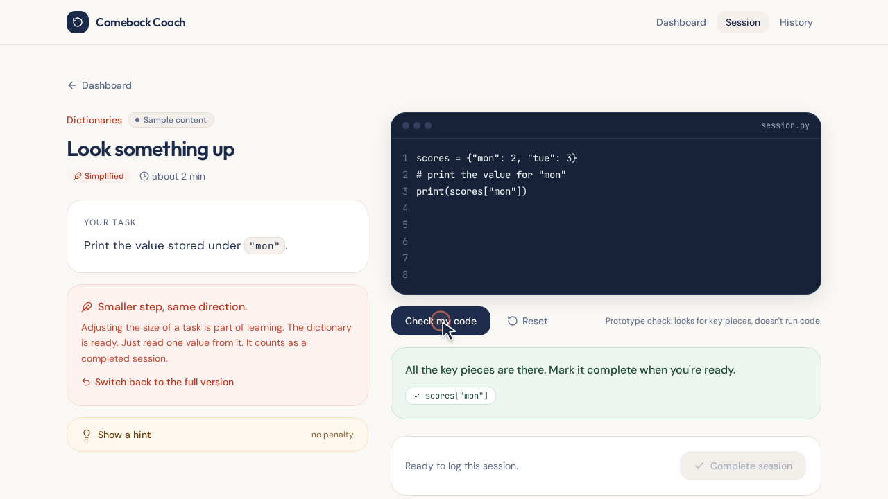
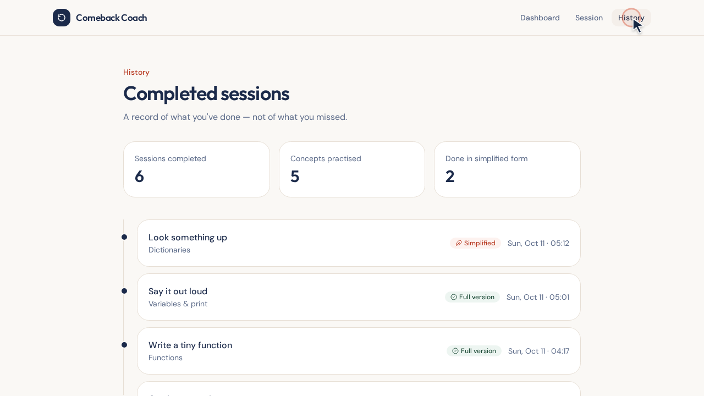

# Comeback Coach
 
**A calm learning companion for people who lost momentum.**
*You don't have to catch up. You just have to start again.*
 
Comeback Coach helps someone return to learning Python after a break. It doesn't count what you missed. It suggests one short session, offers a hint when you need one, and makes the task smaller when that helps.
 
**[Try the live demo](https://kp088.github.io/comeback_coach/)** · 
 
[](https://kp088.github.io/comeback_coach/downloads/comeback-coach-walkthrough.mp4)
 
<sub>Click the image to play the walkthrough video.</sub>
 
## Why I built it
 
Most learning apps punish a break: broken streaks, a backlog of missed lessons, a reminder of how far behind you are. That is exactly when people quit. Comeback Coach is built around the opposite idea: the only session that matters is today's, and a smaller session still counts.
 
## What it does
 
| Feature | How it works |
|---|---|
| **Start from where you are** | The dashboard shows your goal, recent progress and one suggested session. A gap of days is framed without guilt. |
| **One short exercise** | Each session is a single Python task of two to six minutes, written in an in-browser code editor. |
| **A hint when you need one** | Every exercise has a hint, with no penalty for using it. |
| **Make It Easier** | One click swaps the task for a simpler version of the same concept. It still counts as a completed session. |
| **Helpful feedback** | "Check my code" shows which key pieces are present and which are missing. |
| **History** | A record of what you've done, including which sessions were full or simplified, not what you skipped. |
 
Three learning goals are included: **Python basics**, **Working with data** and **Small automations** (eight exercises in total).
 

 
## Tech stack
 
- **Frontend:** React 19, TypeScript, Vite, Tailwind CSS v4, shadcn/ui, TanStack Query, React Router
- **Backend:** FastAPI, Pydantic v2, MongoDB (async, via Motor)
- **Hosting:** GitHub Pages, deployed by GitHub Actions on every push to `main`
## Two ways it runs
 
**Showcase mode (the live demo).** The whole app runs in the browser with no server. The API is mirrored in `frontend/src/lib/demoApi.ts`, and progress is saved in the visitor's own browser, so every visitor gets a private copy. Use **Reset demo** in the footer to start over.
 
**Full-stack mode.** The React frontend talks to the FastAPI backend, which stores progress in MongoDB.
 
## Run it locally
 
Showcase mode, frontend only:
 
```bash
cd frontend
yarn install
VITE_DEMO_MODE=true yarn dev        # http://localhost:3000
```
 
Full stack, in two terminals:
 
```bash
# Terminal 1: backend (needs MongoDB running)
cd backend
pip install -r requirements.txt
# create backend/.env containing MONGO_URL=... and DB_NAME=...
uvicorn server:app --port 8001 --reload
python seed.py                      # optional: sample learner and history
 
# Terminal 2: frontend
cd frontend
yarn install
yarn dev                            # http://localhost:3000, proxies /api to :8001
```
 
## Project structure
 
```
backend/
  server.py            FastAPI app, mounts everything under /api
  routers/coach.py     goals, dashboard, exercises, check, completions
  content/sample.py    the exercises and goals
  models/coach.py      Pydantic models
frontend/
  src/pages/           Home, Dashboard, Session, History
  src/lib/api.ts       typed fetch layer (switches to showcase mode)
  src/lib/demoApi.ts   browser-only copy of the API for the live demo
.github/workflows/     GitHub Pages deploy
```
 
## API
 
All routes live under `/api`.
 
| Method | Route | Purpose |
|---|---|---|
| GET | `/goals` | List learning goals |
| PUT | `/learner/goal` | Switch the active goal |
| GET | `/dashboard` | Progress, recent sessions and the suggested next exercise |
| GET | `/exercises/{id}` | One exercise, with full and simplified versions |
| POST | `/exercises/{id}/check` | Check submitted code |
| POST | `/completions` | Log a completed session |
| GET | `/completions` | Session history, newest first |
 
## Current limits
 
This is a prototype, and these are the honest edges:
 
- The code check looks for key pieces in what you typed. It does not run the code.
- There is no login. The app has a single demo learner named Sam.
- Exercises are hand-written sample content.
## What's next
 
- Run submitted code for real, in the browser
- Accounts, so each learner keeps their own history across devices
- AI-generated exercises matched to the learner's goal
## About
 
Built by **Kirtan Patel**. The first version was prototyped with Emergent AI; I then added the browser-only showcase mode and the GitHub Pages deployment.
 
